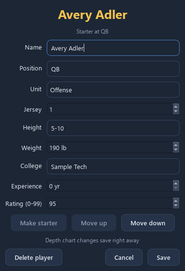
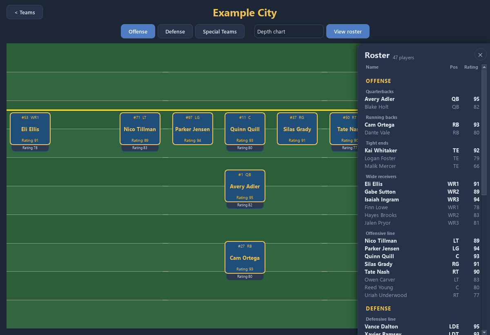
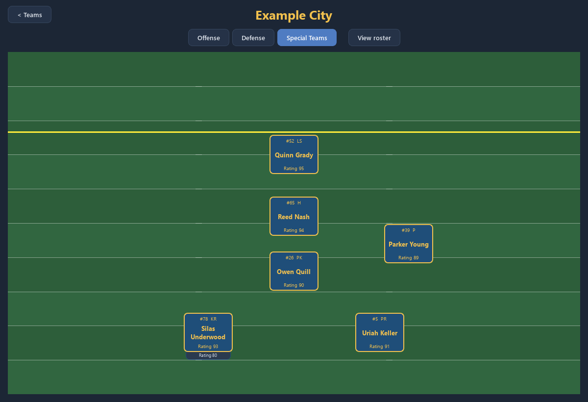
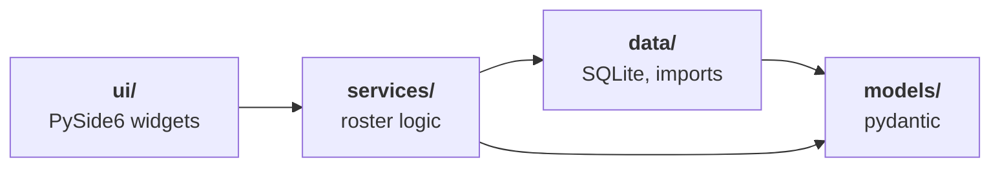

# Roster Manager

[](https://github.com/gabehowell11/roster-manager/actions/workflows/ci.yml)
[](https://github.com/gabehowell11/roster-manager/releases/latest)


[](LICENSE)

A Windows desktop app for managing football rosters. Pick a real NFL team or import your own,
then see the offense, defense, or special teams laid out on a football field: one card per
player, starters in front, backups stacked behind. Edit players, rate them, reorder the depth
chart, and switch formations. Everything is saved locally, so it works offline.

**[⬇ Download Roster Manager for Windows](https://github.com/gabehowell11/roster-manager/releases/latest/download/RosterManagerSetup.exe)**
· one installer, no admin password, adds a desktop icon ·
[User guide](docs/user-guide.md)


## Contents

- [Features](#features)
- [Screenshots](#screenshots)
- [Tech stack and what I learned](#tech-stack-and-what-i-learned)
- [Architecture](#architecture)
- [Testing and quality](#testing-and-quality)
- [Building with an AI coding agent](#building-with-an-ai-coding-agent)
- [Project timeline](#project-timeline)
- [Running from source](#running-from-source)
- [Disclaimer](#disclaimer)

## Features

**Rosters**
- Download any NFL team's current depth chart once; it's stored locally so the app works offline
- Refresh a team later to pick up roster moves, keeping your own player ratings
- Import a custom roster from CSV or JSON, starting from a template the app saves for you;
  every problem in a bad file is listed at once, by row and column

**On the field**
- Offense, defense, and special teams drawn on a field, backups stacked straight behind each starter
- Hover a backup to bring its card to the front
- Formations: Shotgun, Singleback, I-Form, Pistol, Empty, and Goal Line on offense; 4-3, 3-4,
  Nickel, Dime, 3-3-5, and Goal Line on defense
- **View roster** side panel: every player by position group (QB, RB, TE, WR, OL, then defense
  front to back), starters first

**Editing**
- Click a card or a roster row to edit any detail or give a 0-99 rating, in an in-app editor
  over a lightly blurred background
- Reorder the depth chart by dragging cards, right-clicking, or from the editor
- Add players, and delete them from the field, the list, or the editor, always after an
  "Are you sure?" prompt

**Install**
- One-click installer with Start menu entry, desktop icon, and a normal uninstaller; saved
  teams survive upgrades and uninstalls

## Screenshots

| Home | Player editor |
| --- | --- |
|  |  |

| Roster list | Nickel defense |
| --- | --- |
|  |  |

| Shotgun formation | Special teams |
| --- | --- |
|  |  |

## Tech stack and what I learned

| Tool | What it does here | What I learned |
| --- | --- | --- |
| **Python 3.12** | The whole app | Structuring a real multi-package project with type hints everywhere, `pyproject.toml`, and editable installs |
| **PySide6 (Qt)** | Desktop UI: home screen, field view, cards, dialogs, side panel | Custom painting with `QPainter`, widget stacking order, mouse and hover events, drag and drop, style sheets, and how Qt's object lifetimes differ from Python's |
| **pydantic** | `Player`, `Team`, `Roster`, `DepthChart` models | Pushing validation into the model (jersey 0-99, one starter per position, height as `6-2` or inches) so every import path gets the same rules and the same error messages |
| **SQLite** | Local storage in the user's app data folder | Schema versioning with `PRAGMA user_version` and migrations, so saved teams survive app updates |
| **platformdirs** | Finds `%LOCALAPPDATA%\RosterManager` | Keeping user data out of the install folder, which is why uninstalling doesn't delete anyone's teams |
| **nflverse (`nflreadpy`, polars)** | Downloads real rosters and depth charts | Cleaning messy real data: players listed twice in one slot, gaps in depth ranks, teams listing both a 4-3 and a 3-4 defense |
| **pytest** | 338 tests, including offscreen UI tests | Testing GUI code without a screen (`QT_QPA_PLATFORM=offscreen`), fixtures, parametrized tests, and writing a test for each bug before calling it fixed |
| **mypy (strict)** | Type checks `src` and `tests` | How much strict typing catches early, including an attribute that silently shadowed a Qt method, and when a type stub is simply wrong |
| **ruff + pre-commit** | Lint and format on every commit | Letting tools enforce style so code review can focus on behavior |
| **GitHub Actions** | CI on Windows for every PR; release on tags | Pipelines that go past tests: build the exe, run its self-test, install the installer, test it, uninstall, and publish |
| **PyInstaller** | Bundles Python and Qt into `RosterManager.exe` | Hidden imports for lazily loaded modules, bundling data files, and why a one-folder build beats one-file for startup time and antivirus false positives |
| **Inno Setup** | `RosterManagerSetup.exe` installer | Per-user installs without admin rights, shortcuts, a stable `AppId` for upgrades, and matching the taskbar ID so pinning works |
| **Git + GitHub** | Issues, branches, PRs, releases | One branch and small PR per issue, Conventional Commits, stacked PRs, squash merges, and tagged releases |
| **Claude Code** | AI coding agent | See [Building with an AI coding agent](#building-with-an-ai-coding-agent) |

## Architecture



- **What lives where.** `ui/` has the home screen, field view, cards, editor, and roster panel;
  `services/` has depth chart edits, field layout, formations, and roster ordering; `data/` has
  the SQLite repository, the nflverse download, and the CSV/JSON importer; `models/` has
  `Player`, `Team`, `Roster`, and `DepthChart`.
- **Dependencies only point down.** PySide6 is imported only in `ui/`. A test enforces it, so all
  roster logic runs and is tested without a GUI.
- **The UI never touches SQLite.** It calls `RosterService`, which loads, edits, validates, and
  saves in one step, so a failed edit never half-saves.
- **One code path for real and custom rosters.** NFL downloads and CSV/JSON imports produce the
  same `Roster` model and pass the same validation.
- **Layouts are plain data.** Field positions are fractions of the field (0-1), computed in
  `services/`, so the layout is unit-tested and the widget only scales it.

## Testing and quality

- **338 tests** (about 3,700 lines) for about 4,300 lines of app code: models, services, data
  import, and offscreen UI tests that click cards, open dialogs, and check what's drawn.
- **Strict mypy, ruff lint and format**, enforced by pre-commit hooks locally and by CI.
- **CI on Windows for every pull request**: lint, types, and tests. Then it builds the exe and runs
  its `--self-test`, builds the installer, silently installs it, self-tests the installed app,
  checks the shortcuts, uninstalls, and checks everything is gone.
- **Releases are automated**: pushing a `v*` tag that matches `pyproject.toml` runs the same
  checks and publishes the installer.
- **Screenshots are generated, not hand-made**: `docs/make_screenshots.py` renders the app
  offscreen with a made-up team, so the README stays current and contains no real branding.

## Building with an AI coding agent

I built this with **Claude Code**, an AI coding agent, as my pair programmer. Most of the code was
written by the agent from my requirements. My job was product owner, reviewer, and tester:

- Planned the work as GitHub issues in four phases (setup, models and data, UI, editing and
  release), one branch and PR per issue
- Wrote the project rules the agent follows (`CLAUDE.md`): the layered architecture, "no PySide6
  outside `ui/`", tests for every service function, UTF-8 without BOM, Conventional Commits
- Specified the UX: the title-screen home page, straight backup stacks, hover-to-front cards,
  the blurred in-app editor, the roster side panel and its position order, and the add/delete flow
- Reviewed and merged every PR, and tried each feature in the running app

### What the AI got wrong, and how I worked around it

| Problem | How it showed up | Fix or workaround |
| --- | --- | --- |
| **Tests passed, CI still failed** | Qt widgets were freed after the app object during interpreter exit, and Qt aborted with `0xC0000409` even though all tests passed | An autouse pytest fixture closes and deletes leftover widgets after every test |
| **"All tests pass" ≠ "it looks right"** | Styling the editor's number boxes squeezed their text area to 1 pixel, so jersey, weight, and rating showed blank, with every test green | Review generated screenshots after every UI change; added a regression test that the text area keeps its width |
| **Windows Application Control** | The `.exe` launchers in `.venv` (`pytest.exe`, `ruff.exe`) were blocked, and so was running a freshly built `RosterManager.exe` locally | Always run tools as `python -m ...` (written into `CLAUDE.md`); let CI run the built exe and installer, where they aren't blocked |
| **Shell quoting** | A commit message with double quotes was split into separate arguments by Windows PowerShell 5.1. Nothing was committed, an empty branch was pushed, and the PR failed | Write commit and PR text to files and use `git commit -F` and `gh pr create --body-file` |
| **Event-order bugs** | Hovering between stacked backups could leave the wrong card in front, because Qt can deliver the old card's "leave" after the new card's "enter" | Only the lifted card's own leave restores the stack; tests replay the events in the bad order |
| **Wrong guesses about the code** | The agent referenced a field that didn't exist, and named an attribute `scroll`, which hid Qt's own `QWidget.scroll` method | Strict mypy caught both before anything ran |
| **Library stubs that lie** | PySide6's type stubs say `QImage.save` takes bytes for the format; at runtime only a string works | A narrow `# type: ignore` with a comment explaining why, plus a test that exercises the real call |
| **Overstated verification** | A draft PR description said the exe had been self-tested locally, when Windows had blocked it | I treat "tested" claims as unverified until there's output to back them; the PR was corrected to say CI covers it |
| **Shipping isn't merging** | After the installer PR merged, the README download link returned 404: no release had been published yet | Tagging `v0.1.0` runs the release workflow; the maintainer steps below now spell it out |

**Lessons I'd keep:** give the agent written rules and small, well-scoped issues; make CI prove
the things you can't check locally; look at the actual app, not just the test count; and ask
"how do you know?" whenever it says something works.

## Project timeline

Built from November 5 to 18, 2026: 23 issues across four phases, 36 merged pull requests, and a
public [v0.1.0 release](https://github.com/gabehowell11/roster-manager/releases/tag/v0.1.0).

| Phase | What shipped |
| --- | --- |
| 1. Setup | Project scaffold, CI on Windows, mypy and pytest config, pre-commit hooks, README |
| 2. Data | pydantic models with depth chart rules, SQLite repository, nflverse download, CSV/JSON import |
| 3. UI | Roster service, field layout, main window, home screen, player cards, field view, theme |
| 4. Editing and release | Depth chart editing, player editor, formations, special teams, safe refresh, Windows build, docs |
| Polish | Title screen, hover-to-front cards, blurred in-app editor, roster side panel, add/delete players, installer and releases |

## Running from source

Requires Windows 10 or 11 and Python 3.12. In PowerShell:

```powershell
git clone https://github.com/gabehowell11/roster-manager.git
cd roster-manager
py -3.12 -m venv .venv
.venv\Scripts\Activate.ps1
python -m pip install -e ".[dev,data]"
python -m pre_commit install
python -m rostermanager
```

If PowerShell refuses to run `Activate.ps1`, allow local scripts for your user once with
`Set-ExecutionPolicy -Scope CurrentUser RemoteSigned`, then try again.

| Task | Command |
| --- | --- |
| Run the app | `python -m rostermanager` |
| Tests | `python -m pytest` |
| Lint / format | `python -m ruff check .` / `python -m ruff format .` |
| Type check | `python -m mypy` |
| All hooks | `python -m pre_commit run --all-files` |
| Build the exe | `python packaging/build.py` (writes `dist/RosterManager/`) |
| Build the installer | `python packaging/build_installer.py` (needs [Inno Setup 6](https://jrsoftware.org/isinfo.php)) |
| Screenshots | `python docs/make_screenshots.py` |
| Redraw the icon | `python packaging/make_icon.py` |

### Importing from the command line

The home screen does all of this; these are handy for scripting.

```powershell
python -m rostermanager.data.nflverse KC
python -m rostermanager.data.custom_import my_team.csv --team EXC --name "Example City"
```

Custom files use the player fields as columns: `name`, `position`, `unit` (`offense`, `defense`,
or `special_teams`), and `depth_order` (1 = starter) are required; `jersey_number`, `height`
(inches or `6-2`), `weight`, `college`, `years_experience`, and `rating` (0-99) are optional.
Templates are in `src/rostermanager/data/templates/`. A JSON file can include its own `team`.

### Making a release

1. Bump `version` in `pyproject.toml` and merge it to `main`.
2. Tag that commit and push the tag, e.g. `git tag v0.2.0` then `git push origin v0.2.0`.

The Release workflow tests, builds, installs and self-tests the installer, then publishes it.
The download link always points at the newest release.

Windows shows **"Windows protected your PC"** the first time someone runs the installer, because
it isn't code-signed. Users click **More info**, then **Run anyway**.

## Disclaimer

Roster Manager is an independent project. It is not affiliated with, endorsed by, or sponsored by
the National Football League (NFL) or any of its teams. Team names and colors are used only to
identify rosters; the app does not use NFL or team logos or other official branding.

## License

[MIT](LICENSE) © 2026 Gabriel Howell
