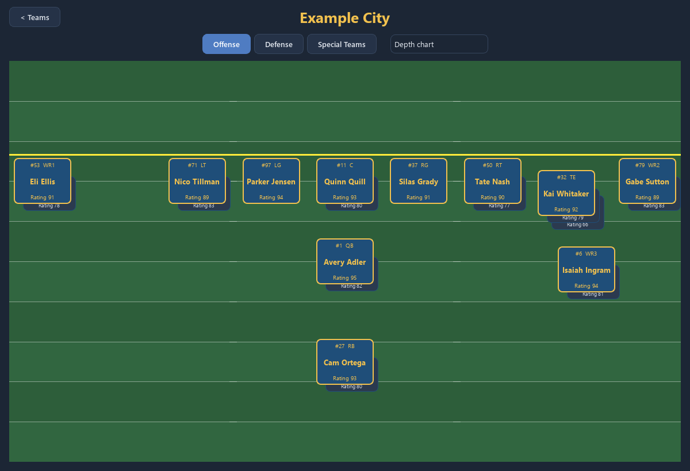
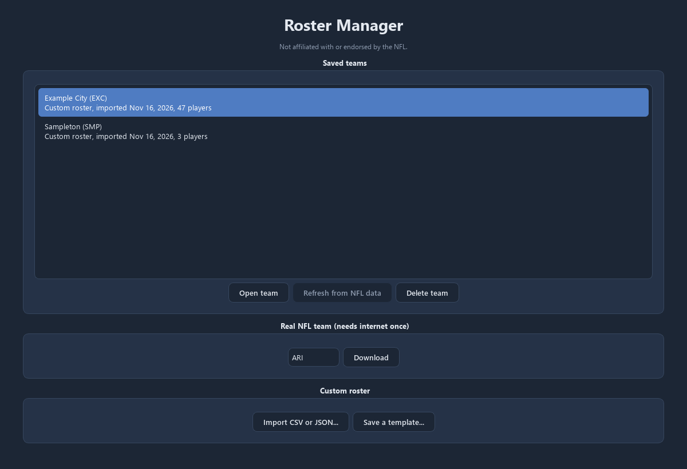
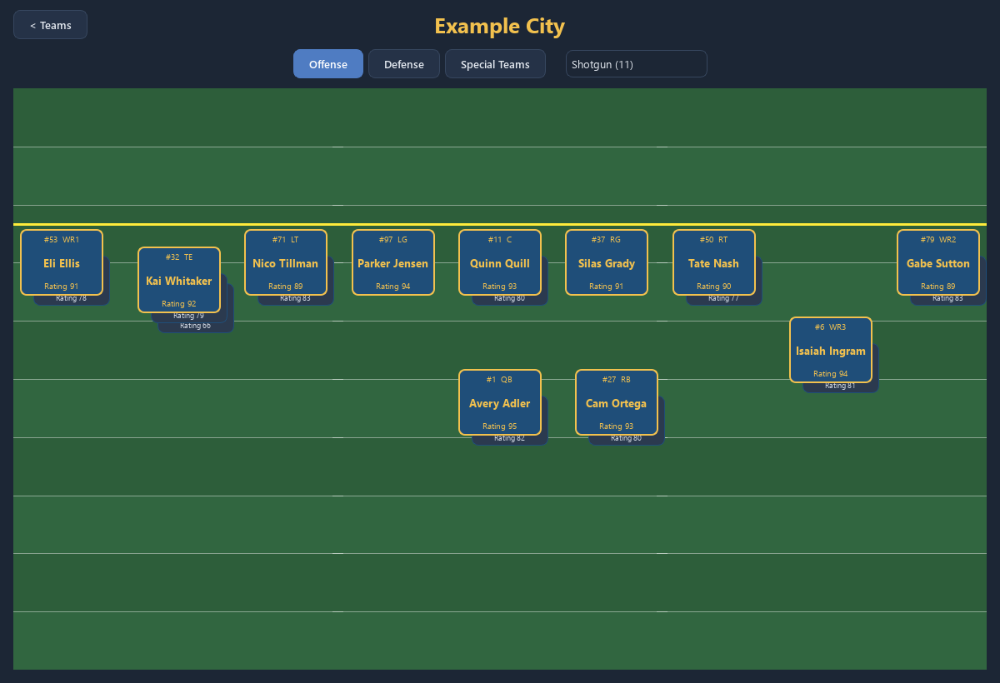
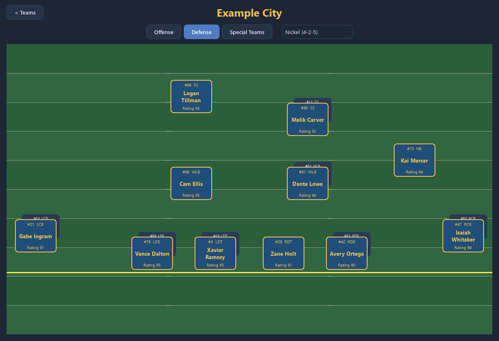

# Roster Manager

[](https://github.com/gabehowell11/roster-manager/actions/workflows/ci.yml)

A Windows desktop app for managing football rosters. Pick a real NFL team or import your own
roster, then see the offense, defense, or special teams laid out on a football field, with each
player shown as a card and starters in front of their backups.

> **Status:** feature complete for version 1 (phases 1-4). See the
> [issues](https://github.com/gabehowell11/roster-manager/issues) for what's next.



## Features

- Download any NFL team's current depth chart once; it is stored locally so the app works offline
- Refresh a team later to pick up roster moves, keeping your ratings
- Import a custom roster from CSV or JSON, starting from a template the app saves for you
- Field view for offense, defense, and special teams, with backups stacked behind each starter
- Formations: Shotgun, Singleback, I-Form, Pistol, Empty, and Goal Line on offense; 4-3, 3-4,
  Nickel, Dime, 3-3-5, and Goal Line on defense
- Click a card to edit any player detail or give them your own 0-99 rating
- Reorder the depth chart by dragging cards, right-clicking, or from the player editor

The [user guide](docs/user-guide.md) walks through all of it.

## Screenshots

| Home | Player editor |
| --- | --- |
|  |  |

| Shotgun formation | Nickel defense |
| --- | --- |
|  |  |

## Download

Each successful build on GitHub Actions uploads a **RosterManager-windows** artifact. Open the
latest [CI run](https://github.com/gabehowell11/roster-manager/actions/workflows/ci.yml), download
the artifact, unzip it anywhere, and run `RosterManager.exe`. Python is not needed. Windows may
show a SmartScreen warning because the app is not code-signed; choose **More info > Run anyway**.

## Requirements (for development)

- Windows 10 or 11
- Python 3.12

## Setup

In PowerShell, from the folder where you want the project:

```powershell
git clone https://github.com/gabehowell11/roster-manager.git
cd roster-manager
py -3.12 -m venv .venv
.venv\Scripts\Activate.ps1
python -m pip install -e ".[dev,data]"
python -m pre_commit install
```

If PowerShell refuses to run `Activate.ps1`, allow local scripts for your user once with
`Set-ExecutionPolicy -Scope CurrentUser RemoteSigned`, then try again.

## Running the app

```powershell
python -m rostermanager
```

## Importing rosters from the command line

The app's home screen does all of this; these commands are handy for scripting.

Download a real team's roster once (needs internet; afterwards the app works offline):

```powershell
python -m rostermanager.data.nflverse KC
```

Or import your own roster from CSV or JSON. Start from a template in
`src/rostermanager/data/templates/` (`roster_template.csv` or `roster_template.json`).
Columns match the player fields: `name`, `position`, `jersey_number`, `unit`
(`offense`, `defense`, or `special_teams`), `height` (inches or `6-2`), `weight`,
`college`, `years_experience`, `rating` (0-99), and `depth_order` (1 = starter).
`name`, `position`, `unit`, and `depth_order` are required; leave other cells blank
if unknown. Each position slot needs one starter, with backups numbered 2, 3, and so
on. Positions with two starters use separate labels such as `LT`/`RT` or `WR1`/`WR2`.

```powershell
python -m rostermanager.data.custom_import my_team.csv --team EXC --name "Example City"
```

A JSON file can include its own `team`, so `--team` and `--name` are optional there.
If anything in the file is wrong, every problem is listed with its row number.

## Development

| Task       | Command                                |
| ---------- | -------------------------------------- |
| Tests      | `python -m pytest`                     |
| Lint       | `python -m ruff check .`               |
| Format     | `python -m ruff format .`              |
| Type check | `python -m mypy`                       |
| All hooks  | `python -m pre_commit run --all-files` |

| Build exe  | `python packaging/build.py`            |
| Screenshots | `python docs/make_screenshots.py`     |

Every pull request runs lint, type checks, and tests on Windows through GitHub Actions, then
builds the app folder, checks `RosterManager.exe --self-test` passes, and uploads it.

`python packaging/build.py` writes `dist/RosterManager/`. That whole folder is the app; zip it to
share. Check a build with `dist\RosterManager\RosterManager.exe --self-test` (exit code 0 means
everything is bundled).

## Disclaimer

Roster Manager is an independent project. It is not affiliated with, endorsed by, or sponsored by
the National Football League (NFL) or any of its teams. Team names are used only to identify
rosters; the app does not use NFL or team logos or other official branding.

## License

[MIT](LICENSE)
