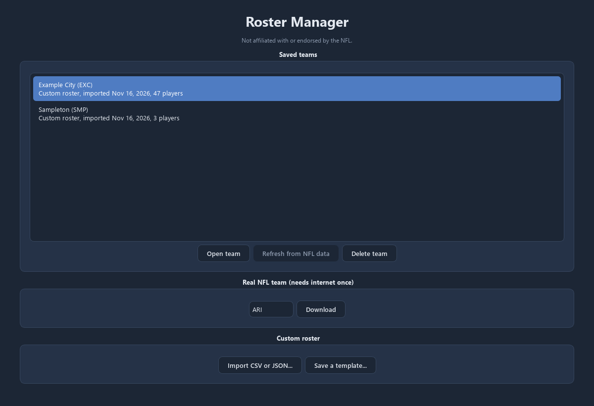
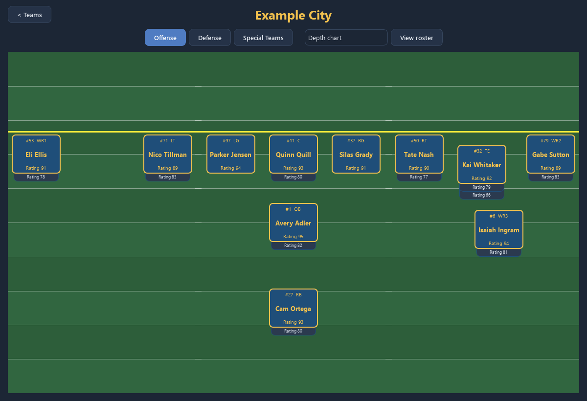
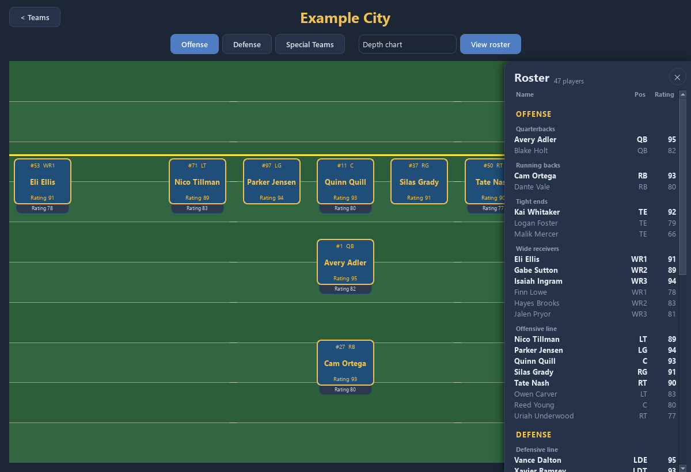
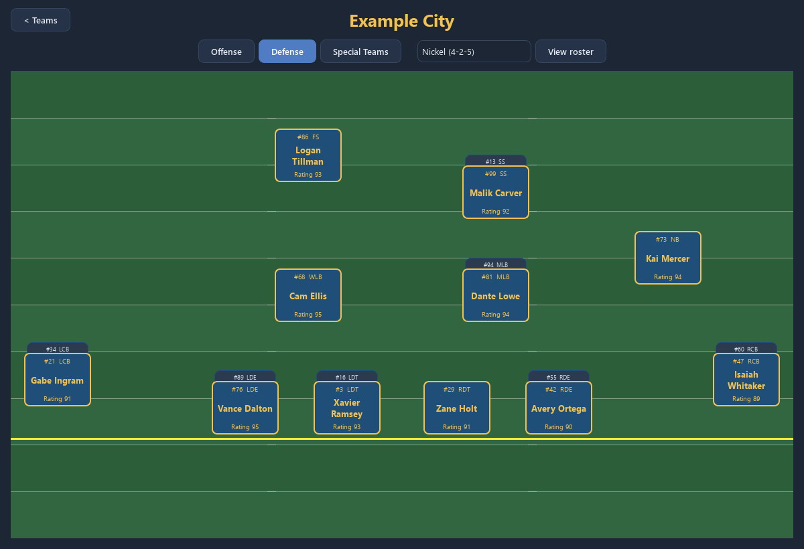
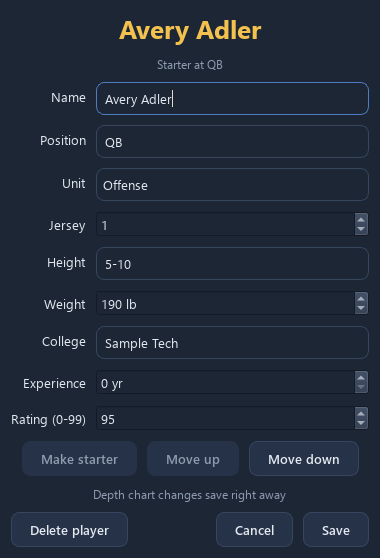

# Roster Manager user guide

Roster Manager shows a football roster on a field: one card per player, with the
starter in front and backups stacked behind. You can download a real NFL team or
import your own roster, then reorder the depth chart, rate players, and view
different formations.

Everything is saved on your computer in
`%LOCALAPPDATA%\RosterManager\rosters.db`. After a team is downloaded once, the
app works offline.

## Getting a team

### Download a real NFL team

1. On the home screen, pick a team abbreviation next to **Download NFL team**
   (for example `KC`).
2. Click **Download NFL team**. This needs internet and takes a few seconds; the window
   stays usable while it runs.
3. The team appears under **Saved teams** with the date it was downloaded.

Only depth chart players are imported (practice squad and deep reserves are
skipped). The data comes from [nflverse](https://github.com/nflverse).

### Import your own roster

1. Click **Template...** and save a CSV (opens in Excel) or JSON file.
2. Fill in one row per player. The columns are:

   | Column | Required | Notes |
   | --- | --- | --- |
   | `name` | yes | |
   | `position` | yes | Up to 5 letters, e.g. `QB`, `LT`, `WR2`, `LCB` |
   | `unit` | yes | `offense`, `defense`, or `special_teams` |
   | `depth_order` | yes | 1 = starter, 2 = first backup, 3, ... |
   | `jersey_number` | no | 0-99 |
   | `height` | no | Inches (`74`) or feet-inches (`6-2`) |
   | `weight` | no | Pounds, 100-450 |
   | `college` | no | |
   | `years_experience` | no | 0-30, blank means 0 |
   | `rating` | no | Your own 0-99 score |

   Each position needs exactly one starter, with backups numbered 2, 3, and so
   on. Positions that field two starters use separate labels, such as `LT` and
   `RT`, or `WR1`, `WR2`, and `WR3`.
3. Click **Import file...** and pick your file. A CSV asks for the team's
   abbreviation (2-4 letters) and name; a JSON file can include its own `team`.

If anything in the file is wrong, every problem is listed at once with its row
number, so you can fix them all in one pass. In Excel, save with
**File > Save As > CSV UTF-8**.

### Refresh, replace, and delete

- **Refresh** downloads a real team again to pick up roster moves.
  Your ratings are kept for players still on the team; depth chart changes and
  edited details are replaced, and the app asks before doing it.
- Downloading or importing a team whose abbreviation is already saved (for
  example a custom team called `KC`) asks before replacing it.
- **Delete** removes a team and everything about it, after asking.

## Viewing a team

Select a team and click **Open** (or double-click it).

- **Offense / Defense / Special Teams** switch the side of the ball. The yellow
  line is the line of scrimmage.
- Each card shows jersey number, position, name, and rating. Hover a card for
  height, weight, college, and experience.
- Backups sit straight behind the starter, peeking out away from the line of
  scrimmage. Up to three backups are shown per position.
- Move the mouse from the starter onto a backup's edge and that backup's card
  comes to the front, so you can read it. Move off it and the stack goes back.
- **< Teams** goes back to the home screen.

### Roster list

Click **View roster** for the whole roster as a list over the right side of the
window: name, position, and rating for every player. Scroll to see everyone.

- Offense comes first (quarterbacks, running backs, tight ends, wide receivers,
  offensive line), then defense front to back (defensive line, linebackers,
  cornerbacks, safeties), then special teams.
- In each group the starters are listed first, in bold, then the backups.
  Positions the app doesn't recognize are listed under **Other**.
- Click a player in the list to open the same player editor as clicking their
  card. The list stays open and updates when you save.
- Close it with **View roster** again, the **X**, or Esc.

### Formations

The drop-down next to the unit buttons switches between the plain **Depth
chart** and a formation:

- **Offense:** Shotgun (11), Singleback (11), I-Form (21), Pistol (11),
  Empty (10), Goal Line (23)
- **Defense:** 4-3, 3-4, Nickel (4-2-5), Dime (4-1-6), 3-3-5, Goal Line (6-2)

A formation picks the best available player for each spot. If a formation needs
more players at a position than the depth chart lists (Goal Line uses three tight
ends), backups fill in. A 3-4 roster viewed as a 4-3 puts its nose tackles
inside. A spot nobody can fill shows a dashed **open** card. The app remembers
your formation for each unit until you close it.

## Editing

All changes save immediately.

### Player details and rating

Click any card to open the player editor. It opens in the middle of the window
with the field lightly blurred behind it; **Cancel**, **Save**, or Esc closes it.

Change any field and click **Save**. Set **Rating** to *No rating* (the lowest
value) to clear it, and leave **Height** blank to clear it. Changing the position
or unit moves the player to the end of that position's depth chart. If a value
is not allowed, the editor says why and nothing is saved. **Delete player**
removes the player after asking; the backups behind them move up.

### Reordering the depth chart

Three ways, use whichever is handiest:

- **Drag a card onto another card** to swap the two players. This works between
  positions too, for example moving a backup corner from `LCB` to `RCB`.
- **Right-click a card** for *Make starter*, *Move up*, *Move down*, or *Edit
  details...*.
- In the **player editor**, use *Make starter*, *Move up*, or *Move down*.

Reordering also works while viewing a formation; it changes the real depth chart
and the formation updates to match.

## Troubleshooting

- **Download failed:** check the internet connection and try again. The message
  shows what went wrong.
- **Import failed:** read the list of problems; each names the row and column.
- **The window is cut off:** the field needs about 1000 x 600 pixels; make the
  window larger or scroll.

Roster Manager is not affiliated with or endorsed by the NFL. It shows team
names and colors only, never logos.
